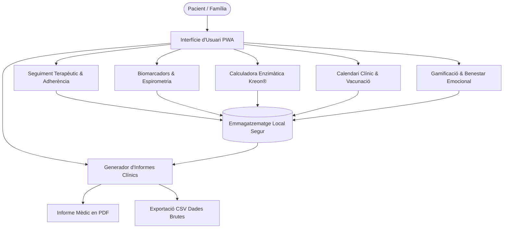

# 🏗️ FQ-UP — Software Architecture & System Design

This document outlines the architectural principles, system design, and security model of **FQ-UP**, a digital health companion for patients with Cystic Fibrosis (CF / Fibrosi Quística) and their caregivers.

---

## 1. Architectural Philosophy: Local-First & Privacy by Design

Digital health applications managing sensitive medical data (spirometry, pharmacological adherence, biometric records) must prioritize patient trust and data sovereignty.

```
┌────────────────────────────────────────────────────────────────────────┐
│                        USER DEVICE (PWA Client)                        │
│                                                                        │
│   ┌────────────────────────────────────────────────────────────────┐   │
│   │                    Presentation Layer (UI/UX)                  │   │
│   │   - Accessible Design System (WCAG AA, Contrast & Scalable)   │   │
│   │   - Multi-language engine (Catalan & Spanish)                 │   │
│   │   - Responsive Layouts (Mobile, Tablet & Desktop)             │   │
│   └────────────────────────────────┬───────────────────────────────┘   │
│                                    │ Events & State                    │
│   ┌────────────────────────────────▼───────────────────────────────┐   │
│   │                       Core Domain Engine                       │   │
│   │   - Treatment Adherence Manager & Nebulization Timer           │   │
│   │   - Kreon® Enzyme Dosage Algorithm (Fat-to-Enzyme ratio)       │   │
│   │   - Spirometry & Biomarker Analytics (FEV1, FVC, SpO2, Weight) │   │
│   │   - Multi-Profile Management (Family & Caregiver Support)      │   │
│   │   - Gamification State ("La Gotita", Streaks & Achievements)   │   │
│   └────────────────────────────────┬───────────────────────────────┘   │
│                                    │ Storage API                       │
│   ┌────────────────────────────────▼───────────────────────────────┐   │
│   │                     Secure Local Persistence                   │   │
│   │   - IndexedDB / Encrypted Local Storage                        │   │
│   │   - Service Worker (Full Offline Availability)                 │   │
│   │   - JSON / CSV / PDF Local Export Pipeline                     │   │
│   └────────────────────────────────────────────────────────────────┘   │
└────────────────────────────────────────────────────────────────────────┘
                                    │
                       Zero External Cloud Leakage
                       (Data strictly stays on-device)
```

### Key Principles
1. **Zero External Cloud Leakage:** In accordance with GDPR and patient privacy best practices, all biometric and therapeutic records are stored exclusively on the user's physical device.
2. **Offline-First Resilience:** Network connectivity is not required for daily therapeutic compliance, guided nebulization, or emergency symptom logging.
3. **Multi-profile Partitioning:** Isolated data stores per patient profile to allow parents to manage treatment for multiple children within one installation.
4. **Export Portability:** Patients own their health data: one-click generation of clinical PDF summaries and raw CSV datasets for hospital visits.

---

## 2. Core Functional Modules



### 2.1 Treatment Adherence & Nebulization
- State machine managing routine intake states: `Pending`, `In Progress`, `Completed`, `Skipped`.
- Precision countdown timer for inhalation therapies with audible and visual stage cues.
- Post-inhalation sanitization checklists to prevent bacterial colonization (e.g., *Pseudomonas aeruginosa* prevention protocol).

### 2.2 Kreon® Enzyme Dosage Calculator
- Interactive dosage helper calculating lipase units dynamically based on grams of dietary fat in meals/snacks, aligning with specialized gastroenterology guidelines.

### 2.3 Biomarker & Clinical Analytics
- Timeseries data collection for:
  - Forced Expiratory Volume in 1 second ($FEV_1\%$)
  - Forced Vital Capacity ($FVC$)
  - Oxygen Saturation ($SpO_2$)
  - Body Weight & Cough Frequency
- Moving-average trend rendering to visualize exacerbation indicators early.

---

## 3. UI/UX & Accessibility Standards

- **High-Contrast Design:** Color palette crafted to exceed WCAG 2.1 AA standards.
- **Dynamic Font Scaling:** Full UI responsiveness across user-defined font sizes.
- **Cognitive Ergonomics:** Calming color palettes, positive reinforcement (streaks, companion mascot *La Gotita*), reducing the daily mental burden of chronic therapy.
