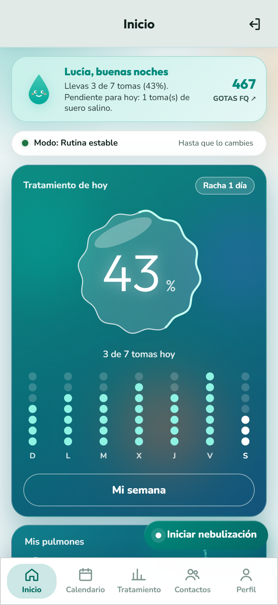
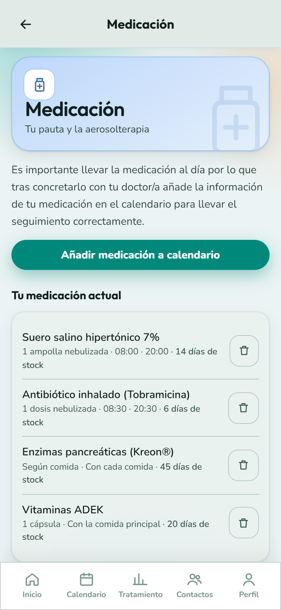
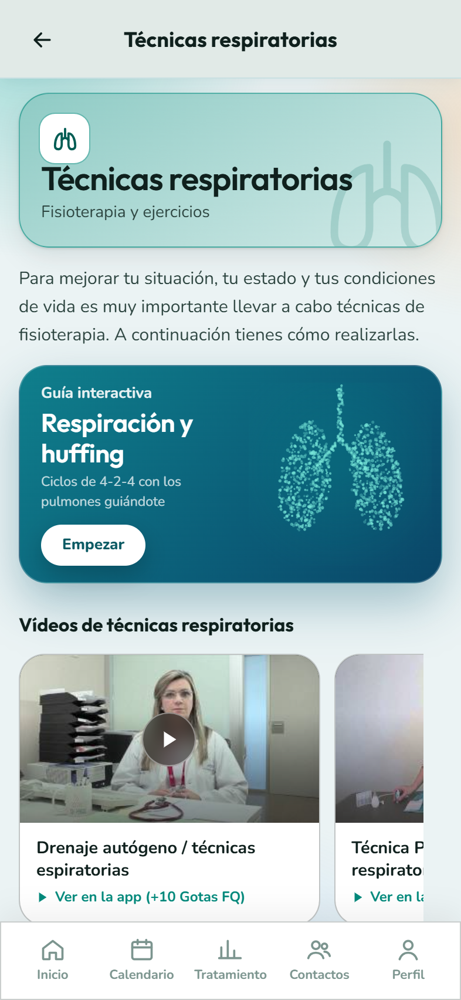
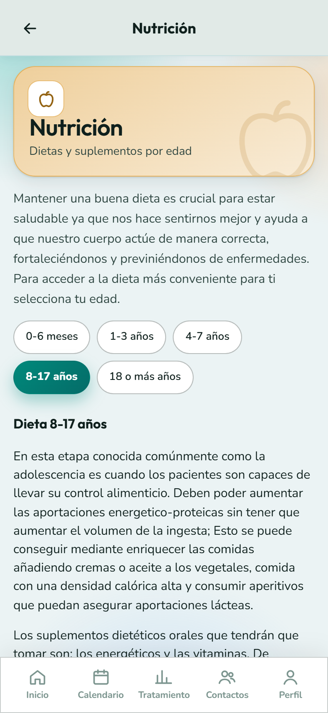
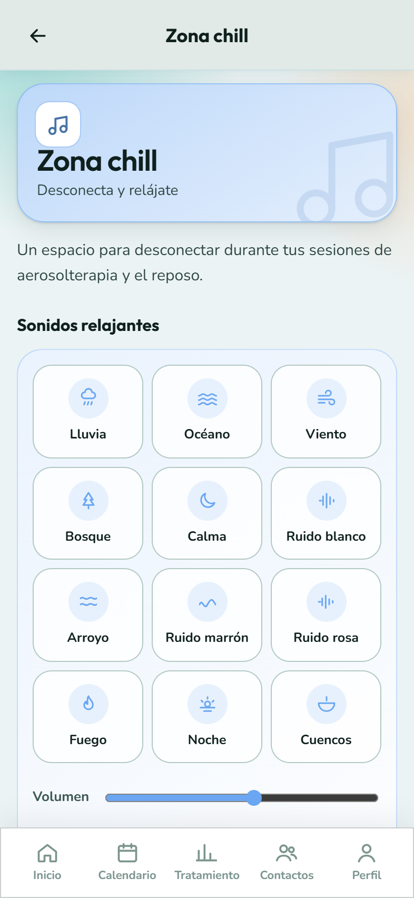
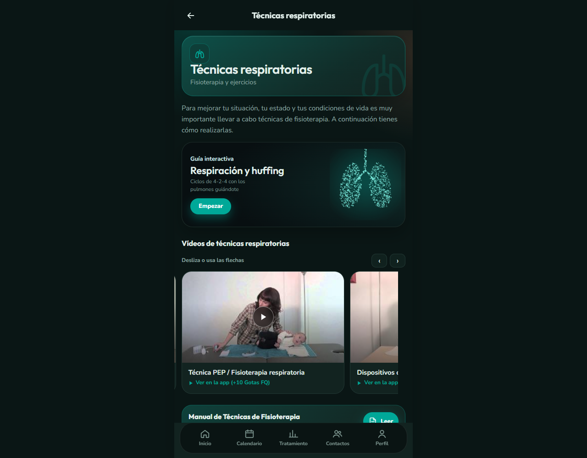

# FQ-UP 💧
### Aplicació d'Acompanyament Integral, Seguiment Terapèutic i Adherència per a la Fibrosi Quística

  <b>Transformant el tractament diari de la Fibrosi Quística en un hàbit accessible, motivador i rigorosament estructurat per a pacients i famílies.</b>

[Visió General](#-visió-general) •
[Captures de l'App](#-captures-de-pantalla) •
[Mòduls Clínics](#-funcionalitats-principals) •
[Arquitectura & Privacitat](#-arquitectura-i-privacitat) •
[Propers Passos](#-colaboració-i-propers-passos) •
[Contacte](#-autoria-i-contacte)

---

> [!IMPORTANT]
> **Avís sobre el Codi Font i Propietat Intel·lectual**  
> El codi font d'aquesta aplicació és **propietari i privat** (actualment en fase de desenvolupament, optimització d'arquitectura de software i refinament UI/UX). Aquest repositori públic actua com a **espai oficial de documentació tècnica, disseny d'arquitectura, modelat del sistema i difusió** del projecte per a la comunitat sanitària, acadèmica i professional.

---

## 💡 Visió General

La **Fibrosi Quística (FQ)** és una malaltia genètica greu i multisistèmica que requereix una rutina terapèutica diària llarga, complexa i molt exigent: nebulitzacions, fisioteràpia respiratòria, antibiòtics inhalats, ajust d'enzims pancreàtics a cada àpat i exercici físic. Mantenir una adherència estricta al tractament és fonamental per frenar el deteriorament pulmonar, però resulta especialment dur per a infants, adolescents i les seves famílies.

**FQ-UP** neix d'un Treball de Recerca d'excel·lència i d'una voluntat clara de donar resposta a aquesta realitat:
- Centralitzar la gestió mèdica diària en una sola eina intuïtiva i agradable.
- Fomentar la **motivació i l'adherència terapèutica** mitjançant reforç positiu i disseny humanitzat.
- Facilitar la comunicació clínica amb els equips mèdics mitjançant **informes automàtics i mètriques objectives**.

---

## 📱 Captures de Pantalla

| Tauler de Control Diari | Guia de Medicació |
| :---: | :---: |
|  |  |

| Fisioteràpia Respiratòria | Nutrició & Guies Clíniques |
| :---: | :---: |
|  |  |

| Benestar & Relaxació | Interfície Adaptada per a Escriptori |
| :---: | :---: |
|  |  |

---

## ⚡ Funcionalitats Principals

### 1. 🫁 Seguiment Terapèutic & Nebulització Guiada
- **Registre diari d'adherència:** Preses de sèrum salí hipertònic, antibiòtics inhalats, fisioteràpia i exercici físic amb indicadors visuals de progrés.
- **Temporitzador assistit:** Cronometratge de sessions de nebulització amb avisos de canvi de fase.
- **Protocol d'higiene:** Llista de comprovació per a la neteja, desinfecció i assecat del nebulitzador, clau per prevenir la colonització bacteriana (*Pseudomonas aeruginosa*).
- **Comptador de ratxa:** Reforç de la constància diària.

### 2. 📊 Biomarcadors & Espirometria
- Registre periòdic de valors espiromètrics essencials: **$FEV_1\%$** (Volum Expiratori Forçat al primer segon) i **$FVC$** (Capacitat Vital Forçada).
- Seguiment de **saturació d'oxigen ($SpO_2$)**, pes corporal, freqüència de tos i tipologia d'esputs per a la detecció primerenca de possibles exacerbacions pulmonars.
- Gràfics de tendència temporals per avaluar l'evolució clínica a mig i llarg termini.

### 3. 💊 Calculadora d'Enzims Pancreàtics (Kreon®)
- Algorisme d'assistència per al càlcul de càpsules enzimàtiques segons la ingesta estimada de greixos en àpats principals i berenars, ajudant a prevenir desequilibris d'absorció nutricional.

### 4. 📅 Calendari Mèdic & Cites Hospitalàries
- Planificació de revisions a la unitat de referència de FQ, recollides de medicació a farmàcia hospitalària i calendari de vacunació específic.

### 5. 📑 Informes Clínics per a la Consulta Mèdica
- **Exportació en PDF:** Resum estructurat de percentatges d'adherència, evolució de biomarcadors i incidències del període per lliurar a l'equip mèdic en cada visita.
- **Exportació en CSV:** Descàrrega directa de dades brutes per a anàlisi clínica detallada.

### 6. 🧸 Motivació, Gamificació & Benestar Emocional
- **La Gotita:** Mascota virtual acompanyant que reacciona a l'estat i assoliments del pacient, incentivant la cura personal.
- **Gotes FQ & Nivells:** Sistema de recompenses basat en la constància terapèutica.
- **Zona de relaxació:** Àudios de respiració guiada, mindfulness i sons relaxants per reduir l'ansietat associada a la malaltia.

### 7. 👨‍👩‍👧 Suport Multifamília
- Gestió de múltiples perfils en un mateix dispositiu (ideal per a famílies amb més d'un fill diagnosticat), amb aïllament complet de registres terapèutics.

---

## 🔒 Arquitectura i Privacitat

FQ-UP està dissenyada sota el principi **Privacy by Design & Local-First**:

- **Emmagatzematge 100% Local:** Totes les dades mèdiques sensibles (espirometries, historial de tractaments, registres diaris) es guarden exclusivament al dispositiu de l'usuari mitjançant emmagatzematge local segur.
- **Zero Fuita al Núvol:** L'aplicació no transmet cap dada biomètrica ni personal a servidors externs sense el consentiment exprés de l'usuari.
- **Progressive Web App (PWA):** Disponibilitat total **offline** mitjançant *Service Workers*, garantint que el pacient pot utilitzar el temporitzador, registrar la medicació i consultar guies mèdiques sense connexió a Internet.
- **Seguretat d'accés:** Bloqueig opcional per PIN i còpies de seguretat locals xifrades.

👉 Per a més informació tècnica, consulta el document detallat d'[Arquitectura de Programari](ARCHITECTURE.md).

---

## 🤝 Col·laboració i Propers Passos

Aquest projecte es troba en fase de refinament actiu per a la seva presentació i validació institucional:

1. **Revisió de continguts clínics:** Avaluació conjunta amb professionals d'unitats especialitzades de Fibrosi Quística (dosis, protocols i terminologia mèdica en català i castellà).
2. **Proves pilot:** Validació d'usabilitat amb un grup controlat de famílies i pacients per optimitzar l'experiència d'usuari i l'impacte en l'adherència.
3. **Contacte institucional:** Proposta de sinergies amb entitats de referència com la **FEFQ** (*Federación Española de Fibrosis Quística*).

---

## 👩‍💻 Autoria i Contacte

Projecte conceptualitzat, dissenyat i desenvolupat per:

**Hira Sheikh Ahmed**  
*Estudiant d'Enginyeria Informàtica (UPC · FIB) & QA / Validació en IA a Grifols*

- 🌐 **Portfolio Web:** [hirasheiikh.github.io](https://hirasheiikh.github.io)
- 💼 **LinkedIn:** [linkedin.com/in/hira-sheikh-ahmed](https://www.linkedin.com/in/hira-sheikh-ahmed/)
- 📧 **Correu:** [hira.sheikh.ahmed@gmail.com](mailto:hira.sheikh.ahmed@gmail.com)
- 💻 **GitHub:** [@hirasheiikh](https://github.com/hirasheiikh)

---

  © 2022-2026 Hira Sheikh Ahmed · FQ-UP · Tots els drets reservats.

